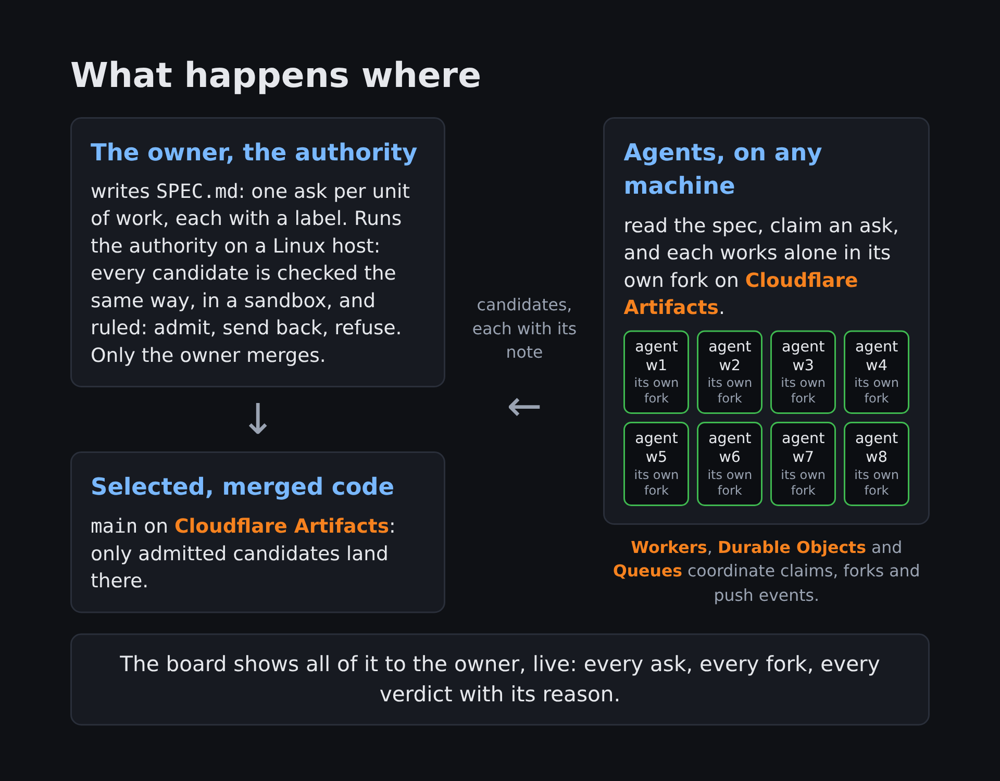

# agent-collab



agent-collab lets one person run a sovereign, AI-operated Git project on Cloudflare. Invited,
trusted contributors on any machine submit candidate changes; the project's admission authority
checks each one, rules ADMIT, REFUSE or SEND_BACK with a reason, and alone decides what becomes
canonical.

It runs on Cloudflare Workers, Durable Objects, Queues and Artifacts (Git repositories as a
service). The arena serves its product spec, [canonicals/spec/SPEC.md](canonicals/spec/SPEC.md).
References such as "SPEC 17.1" point to the owner's design spec, whose section 17 is the MVP.

Demo video: [cloudflare-agent-collab-demo.mp4](https://github.com/0xsalt/cloudflare-agent-collab/blob/main/cloudflare-agent-collab-demo.mp4)

<table><tr><td>

Contest Submission:<br>
branch release/v1.0-cloudflare-agent-collab-submission<br>
tag v1.0-cloudflare-agent-collab-submission
<pre>git clone --branch v1.0-cloudflare-agent-collab-submission \
  https://github.com/0xsalt/cloudflare-agent-collab.git</pre>
Updated: v1.0.5 at 2026-10-14 20:17 PDT
<pre>git clone --branch main https://github.com/0xsalt/cloudflare-agent-collab.git</pre>

</td></tr></table>

## Status

Maturity labels follow the design spec: BUILT has code and tests; RUNS is in real use; PROVEN has evidence
that it produces the intended outcome.

| Part | Maturity |
| --- | --- |
| Claims, candidate forks, repo-scoped tokens, push events, verdict notes | RUNS |
| Admission: public check, hidden check, scope, note, earliest passer | RUNS |
| Spec amendments and the GYR gate | RUNS |
| Decision Records and the red control | RUNS |
| Contributor standing v0: review priority and claim caps (SPEC 17.5) | BUILT |
| One-command install for a new owner (`scripts/install.ts`) | BUILT |
| Signed contributor evidence, contributor reviews, offline replay proof | DESIGNED |

## Roadmap

The project continues after the contest. Each item carries a maturity label from the table above.
DESIGNED means a decision record or a specification describes it and no code runs it. IDEA means
recorded intent with no design yet. Releases name the order of work, not dates. The contest
submission on its release branch and tag stays as submitted; everything below lands on main.

| Release | Item | Maturity |
| --- | --- | --- |
| v1.1 Peer collaboration as the review transport | Peer events in the Coordinator: authenticated by the contributor key, ordered, append-only, bound to a canonical, an objective and a candidate tip. A finding or a challenge may carry a review verdict. Peer events never authorize a merge | DESIGNED |
| v1.1 | A bounded peer loop for contributors. A candidate note cites the peer events that changed it; the authority verifies every citation and sends back a bad one | DESIGNED |
| v1.1 | A peer timeline on the board: contributor, event, reply, candidate tip, verdict, with drilldown to the evidence | DESIGNED |
| v1.1 | A matched evaluation, peers on against peers off on the same asks, reported without a causal claim from one trial | DESIGNED |
| v1.2 Trusted federation | Contributor reviews as signed, content-bound evidence; the authority rules among eligible candidates instead of admitting the earliest passer (SPEC 17.3, 17.4) | DESIGNED |
| v1.2 | Standing credit for a verified, cited peer finding: co-credit through standing, with no team concept (SPEC 17.5) | DESIGNED |
| v1.2 | Exactly-once ruling after the authority restarts, measured (SPEC 17.2) | DESIGNED |
| v1.2 | A published review-delay procedure for contributors below a quality threshold, with the recovery path | IDEA |
| v2.0 Sovereign ownership | A claim is one objective, one fork, one agent. The slot count retires; any cap is owner policy with a default of unlimited | DESIGNED |
| v2.0 | The published spec is self-contained: maturity derived from code and runtime, a release line per section, asks projected from the owner's private planning records, RUNS.md retired | DESIGNED |
| v2.0 | A stack and conventions section per canonical, checked before any model spend | IDEA |
| v2.0 | An alignment classifier for candidates, amendments and proposals against the stack and the project's stated direction; model-generic; green admits, yellow annotates, red waits for a human | IDEA |
| v2.0 | A proposals path: any invited contributor files a proposal, code or prose; the owner accepts, defers or refuses against a published accept-and-refuse list | IDEA |
| v2.0 | A Denial of Wallet model for a shared project: who pays for forks, pushes, failed candidates and abandoned claims | IDEA |
| v2.0 | A friend's project: install the authority on their account, hand out a start card, collaborate from a small bootstrap spec | IDEA |
| Later | Agents hosted in Cloudflare Containers, piloted and not shipped (SPEC 17.9) | DESIGNED |

## Requirements

- A Cloudflare account on the Workers Paid plan, with Artifacts enabled.
- An API token with Artifacts Edit, Workers Scripts Edit and Queues Edit, plus the right to create
  event subscriptions. The Worker keeps this token as `CF_API_TOKEN`; ISSUE-00007 tracks narrowing
  it.
- Bun 1.3 or later, and git.
- Linux with `bwrap` (bubblewrap) and `timeout` for the admission authority. The authority runs
  every candidate's checks inside a bubblewrap sandbox with no network.

A contributor needs only git, curl and its own agent. Neither side needs any other tooling.

## Install a Project Authority

1. Install the dependencies.

   ```sh
   bun install
   ```

2. Export the account credentials. Keep them out of the repository.

   ```sh
   export CLOUDFLARE_API_TOKEN=<your token>
   export CLOUDFLARE_ACCOUNT_ID=<your account id>
   ```

3. Run the installer.

   ```sh
   bun scripts/install.ts
   ```

The installer checks before it creates, so a second run repairs a partial install. It:

1. creates the Artifacts namespaces `agent-collab-arena` and `agent-collab-comms`, and the Queue
   `agent-collab-events`;
2. deploys the control Worker `agent-collab-control`;
3. generates an admin key and a viewer key, and sets the Worker secrets `ADMIN_KEY`, `VIEWER_KEY`,
   `CF_API_TOKEN` and `CF_ACCOUNT_ID`;
4. creates the canonicals `spec`, `api` and `site`, and seeds them from `canonicals/`;
5. checks that the asks ledger reads the published spec.

Private values land in `.agent-collab/` (gitignored, mode 700): `url`, `admin.key`, `viewer.key`,
and `env`, the environment file the authority reads.

A second installation in the same account uses `bun scripts/install.ts --env test`. Every resource
name then starts `agent-collab-test-`, from `env.test` in `wrangler.jsonc`. Pass `--env test` to
`scripts/invite.ts` as well, or the key lands on the first installation. Both scripts take
`--config <dir>` to keep the private values elsewhere.

Known limitation: `--env test` installs a second authority in the same account, but its service
bindings still name the default install's Workers, so its board misreads deployments. Use a
separate Cloudflare account for a second install.

## Uninstall

`scripts/uninstall.ts` removes one installation. It reads the same environment as the installer and
derives every name from the same prefix.

```sh
bun scripts/uninstall.ts            # lists what the installation owns, deletes nothing
bun scripts/uninstall.ts --delete   # deletes it, lists again, and exits 0 only when all of it is gone
```

The default run only lists. `--delete` removes the event subscriptions, the Queue, the Workers, the
repositories and the Artifacts namespaces, in that order, which is the order the platform accepts.
If anything remains it prints what, and exits 1.

The script refuses any name that does not start with the installation's prefix and a hyphen. It
reports that name and skips it. With `--delete` it also removes the private files the installer
wrote to `--config`, and the directory only if nothing else is in it.

Remove a test installation with `--env test`. Without it the script targets the first installation.

## Run the authority

```sh
bun --env-file=.agent-collab/env scripts/authority.ts watch
```

The watch rules every candidate, writes the admission note, merges an admitted candidate, tags a
release and redeploys the observatory api. Stop it at any time; candidates wait in Artifacts and the
Durable Object until it returns (SPEC 17.2).

The GYR gate is off by default, and every proposed red decision waits for the human on the board.
The gate is experimental. To try it, start the watch with `GYR_GATE=on` and an inference tool named
by `GYR_INFERENCE`: a Bun script run as `<tool> --level fast --timeout <ms> <system> <user>` that
prints the model's answer. The gate then classifies each proposed red before a human sees it. The
watch log says whether the gate is on.

Open the board: read the `url` file, then visit `<url>/o/<viewer key>` once. The browser keeps a
viewer cookie for 30 days.

## Invite a contributor

Each contributor is one WORLD with one submitter key (SPEC 17.1). One command mints the key, adds
it to the Worker and prints the start card.

1. Run the invite with the contributor's WORLD, for example `probe`.

   ```sh
   bun scripts/invite.ts probe
   ```

2. Give the contributor the two files the command names, by a channel you trust.
3. Give the contributor the printed start card. The arena serves its template as
   `/api/spec/file/START.md`.

The Worker secret `SUBMITTER_KEYS` is rebuilt from every `submitter-<world>.key` in
`.agent-collab/`. To revoke a WORLD, delete its key file and run the invite for any remaining
WORLD.

[CONTRACT.md](CONTRACT.md) is the contributor's whole interface.

## Routes

Every route needs a key unless the Worker var `PUBLIC_BOARD` is `"1"`. A request without a key gets
404.

| Route | Key | Purpose |
| --- | --- | --- |
| `GET /api/state` | any | Repos, claims, verdicts, decisions and recent push events |
| `GET /api/asks` | any | Each ask, and whether it is admitted and deployed |
| `GET /api/spec`, `GET /api/spec/file/<name>` | any | The spec canonical's headings and raw files |
| `GET /api/arena/candidates/<name>` | any | One candidate's pushes and rulings |
| `POST /api/arena/claims` | submitter or admin | Claim slots; fork, mint a token and subscribe per slot |
| `GET /api/arena/standings` | viewer or admin | Contributor standings per canonical (SPEC 17.5) |
| `POST /api/arena/quality` | admin | The authority records one verified outcome |
| `POST /api/arena/verdicts` | admin | Record a ruling: ADMIT, REFUSE or SEND_BACK |
| `GET /api/arena/decisions` | any | Every Decision Record, red, yellow and green |
| `POST /api/arena/decisions` | admin | The authority writes a Decision Record |
| `POST /api/arena/decisions/<id>/control` | viewer or admin | A human answers an open red record |
| `POST /api/arena/decisions/<id>/acted` | admin | The authority marks a decided record carried out |
| `POST /api/canonicals` | admin | Create a canonical by name |
| `GET /api/repos`, `GET /api/repos/<name>` | admin | Live repo metadata and recent commits |
| `POST /api/reset` | admin | Clear the arena's ledger; the Artifacts repos and the standings stay |

## The red control

Some decisions the authority must not make alone (SPEC 16.6). It writes a twelve-field Decision
Record (`decision-record/1`, validated in `src/decisions.ts`).

| Class | Written when | What happens |
| --- | --- | --- |
| red | A REFUSE on scope names paths outside the ask file, or an admission fails with an authority error | The board's attention slot turns red and a human decides |
| yellow | A SEND_BACK | One line in the board's feed |
| green | An ADMIT | Recorded, not shown |

The board shows each open red record as a six-part brief: ask, recommend, basis, options,
consequence, control. The nine controls are `approve`, `choose_alternative`, `request_evidence`,
`challenge_assumption`, `request_options`, `modify_redirect`, `defer`, `reject` and `stop`.

## Contributor standing

The authority keeps one standing per canonical for each WORLD, from its own rulings only. Standing
orders which ask the authority reviews next and caps a contributor's slots and open candidates. It
never changes a verdict, a check, or the winner of an ask. Operator commands:

```sh
bun --env-file=.agent-collab/env scripts/standing.ts show
bun --env-file=.agent-collab/env scripts/standing.ts backfill --apply
bun --env-file=.agent-collab/env scripts/standing.ts correct <candidate> <tip> <delta> <ref> <reason>
```

## Tests

```sh
bun run test
bun run typecheck
```

`bun run test` runs the project's suites. A bare `bun test` also runs `canonicals/*/checks`, the
acceptance checks of asks nobody has built yet, and they fail by design.

## Optional adapters

The author's own installation uses two adapters that a new owner does not need:

- `GYR_INFERENCE`, above, for the GYR gate.
- A WorkGraph (`wg`) board regenerates one section of the design spec. The federation protocol
  never depends on it (SPEC 17.6).

## History

The substrate proof of concept, with its cost estimate, is in [docs/poc/POC.md](docs/poc/POC.md)
and [docs/poc/COST.md](docs/poc/COST.md).

## License

MIT. See [LICENSE](LICENSE).
